# Orbit

[](https://github.com/imrj05/orbit/actions/workflows/ci.yml)
[](LICENSE)
[](https://rustup.rs/)

**Orbit** is a native desktop workbench for the [pi coding agent](https://github.com/earendil-works/pi) — a chat-style GUI rendered entirely in Rust on GPUI, the GPU-accelerated UI framework Zed is built on. It speaks the pi CLI's RPC protocol directly over stdio: no browser, no webview, no Node.

Sessions you create in Orbit and in the terminal are the same sessions (`~/.pi/agent/sessions/`), managed by pi's own session manager.

## Screenshots

A live session — streaming transcript, tool rows, and the composer:

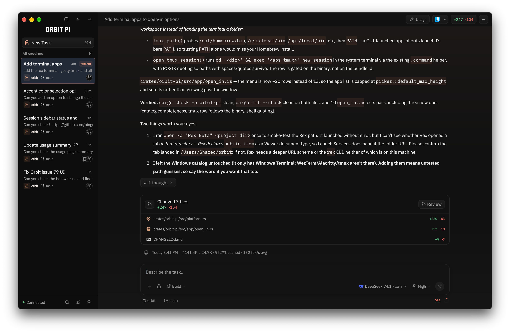

Usage — requests, tokens, cost, and cache, read from your own sessions:

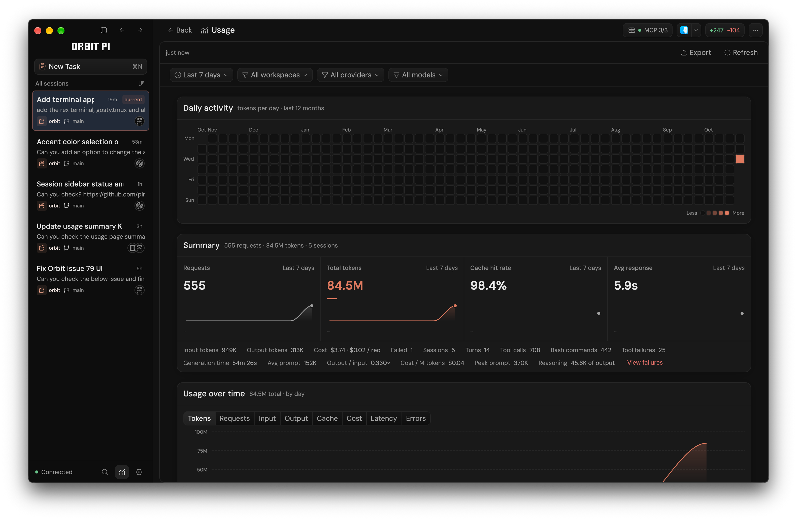

| New task | Review |
| --- | --- |
| 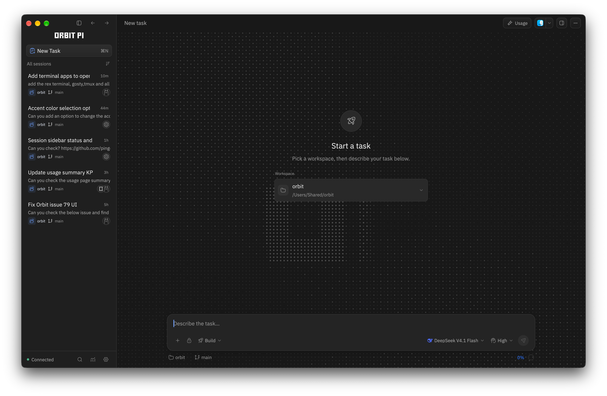 | 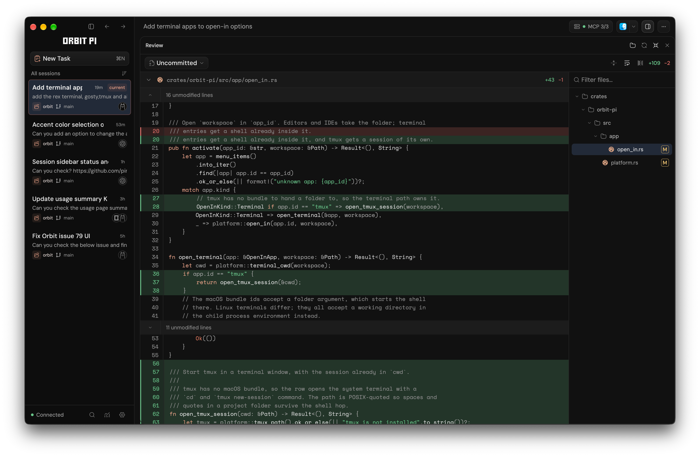 |
| **Git** | **Providers** |
| 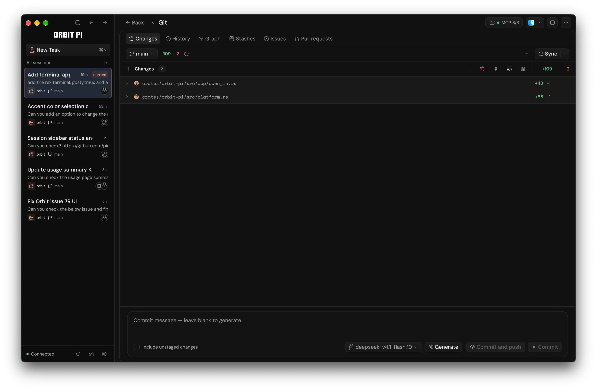 | 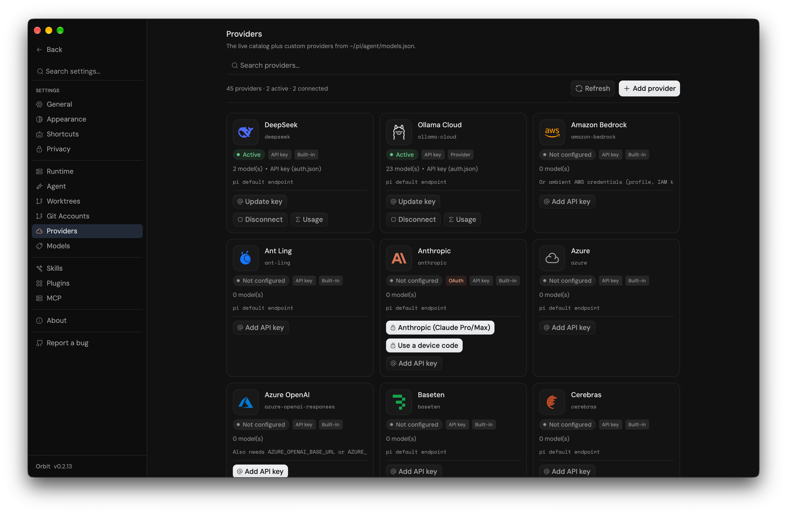 |
| **Plugins** | **Skills** |
| 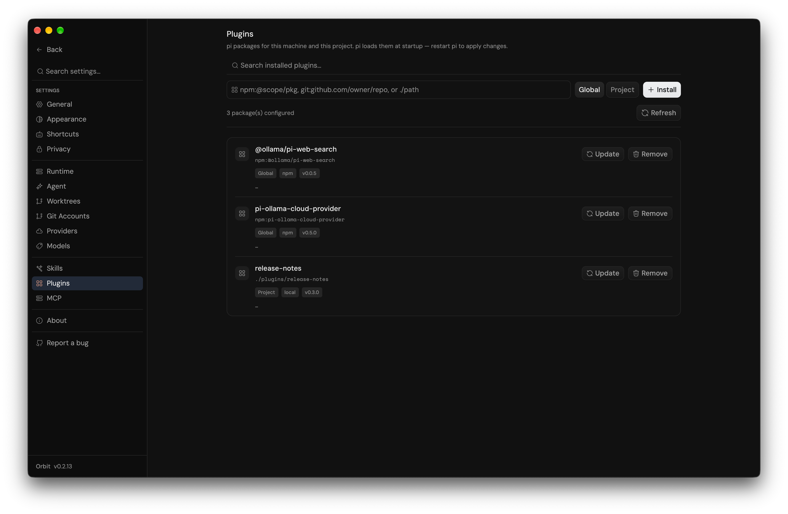 | 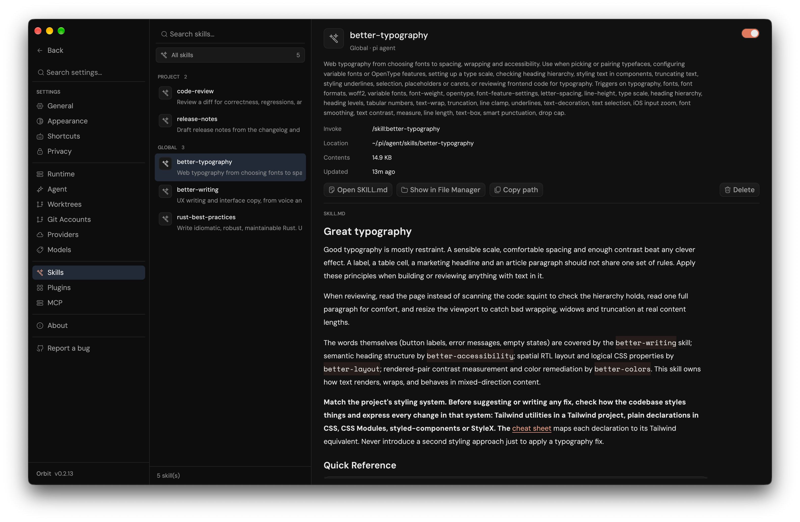 |
| **Models** | **Appearance** |
| 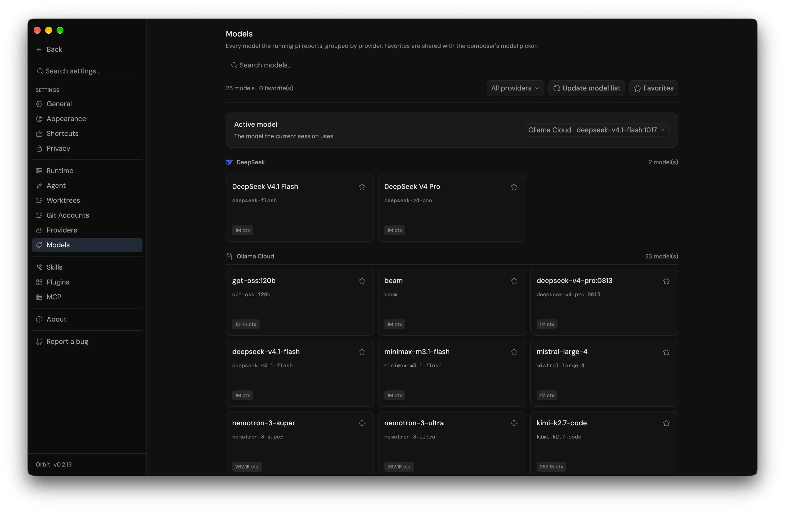 | 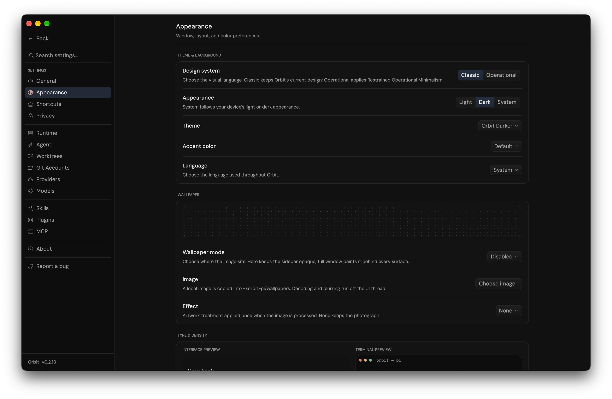 |
| **General** | **Agent** |
| 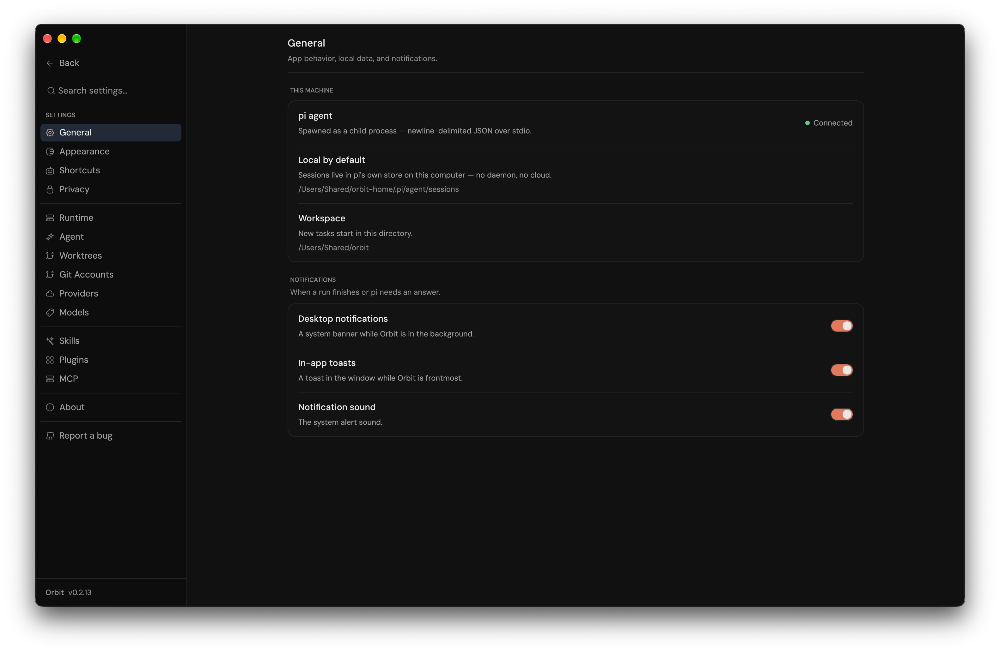 | 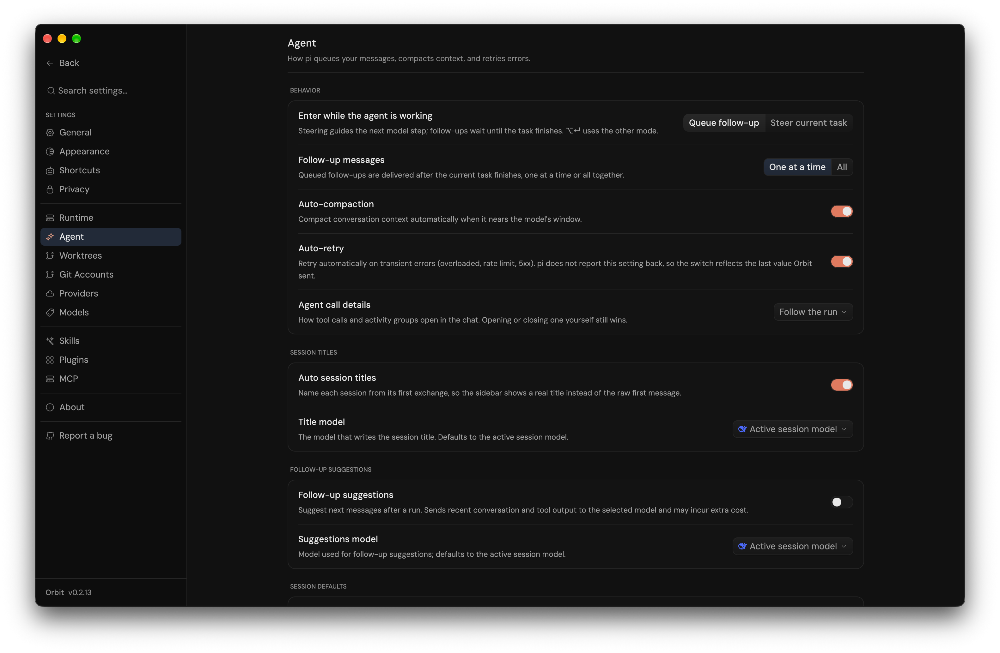 |

## Features

**Chat and transcript**

- Chat-style agent sessions — composer with model selection, thinking effort, follow-up queueing, mid-run steering, cancel, and streaming replies
- A send is in flight from the keystroke: pressing Enter flips the composer to Stop and starts the live “Working for…” row at the send, instead of waiting for pi’s first streamed token. A second Enter queues a follow-up rather than racing a second prompt, and a prompt pi rejects unwinds that state
- **Enter behavior** — Settings → Agent → Behavior picks what Enter does: queue a follow-up (default) or steer the running task. Alt/Option+Enter uses the other mode, and ⌘⇧Enter / Ctrl+Shift+Enter always steers
- Compact hints immediately left of the context-window indicator show both sending modes while the agent is working. Steering takes effect after the current response and tools finish; idle Enter sends normally, and Shift+Enter inserts a new line
- **Workflow modes** — scope a session to **Plan**, **Build**, or **Ask**: Plan and Ask are read-only (write tools disabled, bash gated), so you can explore and plan before switching to Build
- GPU-rendered transcript — virtualized so cost is independent of message count, with stick-to-latest streaming and coalesced commits
- GFM markdown and syntax-highlighted code; highlighting is paint-only so streaming code blocks never reflow
- **Mermaid flowcharts drawn natively** — a `flowchart`/`graph` fence paints as a real diagram
  (GPUI paths and text, no webview), with the copyable source one click away; every other
  Mermaid diagram type keeps the honest source block instead of a fake preview
- In-transcript find (⌘F) and a full-window image lightbox
- **Compressed image attachments** — images you attach or paste are downscaled and re-encoded at ingest (1400 px longest edge, 512 KiB base64, JPEG; transparency keeps lossless WebP), so a large screenshot no longer bloats the prompt or the session history; the status line reports the before/after size
- **An attachment tray for images, files, and long pastes** — every queued item is one chip above the input showing what it is (image thumbnail or file-type badge), its name, its size or line count, and its own remove button; two or more chips add a count header with **Clear**. Dropping or picking a non-image file queues it as a file chip instead of splicing a path into the sentence, and on send it folds into the prompt as an `@path` mention the agent opens with its tools. The sent message shows those files as the same chips under the bubble (the path stays selectable), so a reloaded session looks like the live send. All three kinds share one eight-item budget
- Tool activity — bash, edit, read, and thinking rows drawn natively, expanding into Arguments/Output cards with per-section copy

**Sessions**

- Grouped by project, persistent, reopenable, and cross-workspace
- Orbit-owned project list — remove a workspace from the sidebar without deleting pi's sessions
- Sort projects by last activity, recently added, name, or session count
- Rename, pin, clone, or delete sessions, and copy a session id; pinned sessions sort first
- Address sessions by position — **⌘1…⌘9** (**Ctrl+1…9**) opens the Nth visible session, **Ctrl+Tab / Ctrl+Shift+Tab** cycle them
- Sessions written by the CLI or another window refresh the sidebar live
- Background turn notifications — a desktop banner and alert sound when the window isn't frontmost, an in-app toast otherwise, and a heads-up when a run is waiting on an extension dialog

**Safeguards**

- Access modes — Supervised, Auto-accept edits, or Full access, chosen from the composer
- Enforced by a bundled pi extension that hooks `tool_call` and confirms mutating calls the mode does not auto-approve
- An inline bar above the composer offers **Allow once / Always allow this tool / Deny** (↑ ↓ ⏎ esc), with the allowlist recorded per mode
- A confirmation guard, not a sandbox — pi ships no sandbox, and Orbit does not add one

**Review and Git**

- Review side pane with selectable sources — **Last Turn** (exactly what one agent turn changed, from per-turn checkpoints), Uncommitted, Unstaged, Staged, Committed, and Branch, refreshed when a run settles
- Diff view controls: collapse or expand each file, wrap or pan long lines, unified or side-by-side rows, docked / full-page / minimized, and full keyboard operation (Tab focus stops, arrows, `n` / `p` between files, `[` / `]` between hunks)
- Git page for Changes / History / Graph / Stashes: staging, commit (⌘↵), stash push/pop/apply/drop, sync, push (including force-with-lease), pull, fetch, merge, and rebase, with recovery actions for rejected pushes and conflicts
- The commit bar's **Generate** button has its own model picker — a searchable chip beside it — so commit messages can run on a different (or smaller, local) model than the chat session, with **Active session model** restoring the default
- Git page's Issues and Pull requests tabs through `gh`: browse and filter, file issues and PRs, comment, apply labels, close/reopen, review, merge, and check out a PR's branch — with repository templates and an AI **Generate** action that drafts a title and body from the branch, its commits, optional notes, and the repo's own template
- Git worktrees as first-class workspaces — a Worktrees page lists and creates worktrees (`repo/.wt/113` → `feature/issue-113`), opens them as the active workspace so the Explorer, terminal, Git page, Review, and agent all run there, and supports rename / move / lock / remove / prune / repair
- The status bar's **Work in** chip switches between Local and any worktree, or opens a quick create with a custom worktree name
- An optional per-repository setup script runs asynchronously with `ORBIT_ROOT_PATH` and `ORBIT_WORKTREE_PATH`

**Explorer and Files**

- Project panel (⌘⇧E) — a gitignore-aware workspace tree with expand/collapse, filter, hidden-files toggle, devicons, `M/A/D/R/U` git badges, and keyboard navigation
- File operations from the tree: new file, new folder, rename, and delete to Trash, plus open / reveal / copy path actions
- Files page with a tab strip and an editor for the active workspace: syntax-highlighted editable buffers, Markdown Edit/Preview, images, debounced autosave (and ⌘S) with dirty/saving state, and honest read-only guards for binary, oversized, truncated, and non-UTF-8 files

**Terminal**

- Integrated terminal (⌘J) — a real login shell in a resizable bottom panel, built on `alacritty_terminal` for PTY and VT/ANSI emulation and rendered natively by GPUI: scrollback, click-drag selection (⌘C/⌘V), bracketed paste, a blinking cursor, a per-theme ANSI palette, and restart; the shell follows the active workspace
- **Terminal tabs** — ⌘T opens another shell in the current workspace, ⌘W closes the active one (the panel closes with its last tab), and ⌘⇧] / ⌘⇧[ (**Ctrl+Shift+] / Ctrl+Shift+[**) step between tabs
- The tab chords are scoped to the terminal, so Ctrl+Tab still reaches the shell. On Windows and Linux, where Ctrl+T and Ctrl+W belong to the shell, the tab chords are Ctrl+Shift+T / Ctrl+Shift+W
- A background tab keeps its PTY alive, so a build left running in one tab keeps running while you work in another, and switching sessions no longer kills the shells
- Each tab carries its login shell’s mark (zsh, bash, fish), with the shell name and start directory on hover

**Workbench**

- Usage, skills, plugins, models, providers, MCP, appearance, and agent/runtime settings, backed by pi's on-disk data
- **MCP** — manage pi's MCP servers (global and per project) in Settings → MCP: add / edit / validate, a `${NAME}` secret store, live status and tool lists from `pi mcp list --json`, and applying changes by respawning pi with the session preserved
- Providers — pi's live catalog plus custom endpoints (`models.json`), with API-key or OAuth sign-in and usage meters
- Plugins — install pi packages from npm, git, or a local path, global or per project; update checks and update/remove in place
- Models — read from pi's own runtime, with a **default session model** and thinking level (Settings → Agent) applied to every new session; the choice lives in Orbit's own store and leaves pi's global settings alone
- **Auto session titles** — a bundled pi extension names a session after its first turn, with a model picker and an on/off toggle in Settings → Agent
- **Report a bug** — Settings → Report a bug takes an issue type (bug / feature / other) and the bug context, then **Generate draft** writes the title and description with the app's active model
- It files the issue against the project with your build details attached (Orbit version, app ID, OS and architecture, install kind, pi CLI, and `gh` account): through the `gh` CLI when it is signed in, or as a prefilled GitHub new-issue page otherwise
- Screenshots attach too. They upload with `gh issue create --attach` when `gh` is signed in, and otherwise the web form opens with the images saved to a temp folder to drag in
- **Privacy** — Settings → Privacy archives or deletes idle `pi` sessions on a schedule you choose
- It also lists Orbit's own scratch files in the `orbit-pi` folder inside the system temp directory (bug-report screenshots, update downloads, helper scripts), with **Open folder** and **Clean up now**. Older top-level `orbit-*` leftovers are included, and entries a live Orbit process still needs are kept
- A separate **AI scratch files** group lists pi's own `pi-*` temp entries (shell output, codemode images, share/editor working files) and removes only those last used more than an hour ago
- Appearance — **Light / Dark / System**, a persisted **Design system** choice (**Classic** keeps the existing palette and geometry; **Operational** applies the near-black, lime-accented Restrained Operational Minimalism system), independent light and dark theme palettes, a background image, fonts, sizes, spacing density, and **interface language** (English, 简体中文, 日本語, 한국어, Español, Français, Deutsch, Português do Brasil, Русский, Italiano, or the system language)
- System follows OS appearance changes live; new installations use System, while existing theme choices are preserved. Switching design systems is opt-in and does not modify the Classic palettes or their geometry
- With no image set, the new-task page carries a living ordered-dither field with the app monogram screened into it: it follows the palette, drifts slowly enough to breathe instead of strobe, and freezes under Reduce Motion
- No telemetry: no analytics client, no identifier, and no queue (see [PRIVACY.md](PRIVACY.md))

**Native**

- A command palette (⌘P / ⌘K) and a registry-driven shortcut layer: the keymap, palette chips, and the Settings → Shortcuts reference all read from one command table, with Tab focus traversal, context-aware keys (review tree, pickers, dialogs), custom macOS window chrome, native dialogs, and reduce-motion
- Zed's design tokens (spacing and density, type, icon and button sizes, elevation, motion) in `theme/tokens.rs`, scaling with the UI font size and Spacing Density settings — settings, usage, the sidebar, transcript chrome, the palette, pickers, modals, the Explorer, the Git panel, and the terminal use them today, with the composer the last major surface
- **Open in** — open the workspace in a detected editor or terminal right from the header, with each app's real icon
- macOS window handling — closing the window keeps the session, its pi process, and any running stream alive; clicking the Dock icon reopens that same session, and a run that settles with no window open still posts its notification
- A first-run dependency check for `pi`, `node`, and `git` that reports anything missing with its install command
- Signed releases: macOS `.dmg` (signed + notarized, universal) and `.tar.gz`, Windows `.exe` / `.zip`, Linux `.deb` / `.tar.gz`, with signed in-app updates on every platform

## Structure

```
┌───────────────────────────────────────────┐
│  Orbit (Rust) — GPUI, Metal-rendered UI   │
│  crates/orbit-pi                          │
│  window, transcript, markdown, workbench  │
└──────────────┬────────────────────────────┘
               │ newline-delimited JSON RPC over stdio
┌──────────────▼────────────────────────────┐
│  pi CLI (child process, per open session) │
│  pi --mode rpc — sessions, models, tools  │
└──────────────┬────────────────────────────┘
               │
┌──────────────▼────────────────────────────┐
│  ~/.pi/agent/ — sessions, config, usage   │
│  (same data the pi CLI uses)              │
└───────────────────────────────────────────┘
```

Orbit spawns the `pi` CLI as a child process per open session and speaks its RPC protocol: JSON requests on stdin, JSON-line events on stdout (text/thinking deltas, tool calls, question dialogs, settle signals). Everything user-facing is painted by GPUI on Metal — no DOM, no CSS, no browser engine. The agent runtime stays `pi` itself, so the model catalog, thinking levels, and persistence remain pi's own.

### Project layout

```
crates/orbit-pi/      The GPUI app — window, transcript, markdown, workbench
crates/orbit-rpc/     pi CLI RPC client (process lifecycle + JSONL protocol)
contrib/              Bundled pi extensions (access guard, auth/quota bridges)
scripts/make-dmg.sh   Build a signed .app + DMG (arm64 / universal)
assets/icons/         App icon (logo-icon.png source, icon.icns, icon.png)
marketing/            Next.js landing page
PRODUCT.md            Product definition, capabilities, constraints
INTENT.md             Architecture decisions + phase plan
AGENT.md              Conventions for agents and humans working on this repo
PRIVACY.md            What Orbit does and does not send
```

## Roadmap

Orbit is a workbench, not just a chat window. The confirmed direction lives in
[PRODUCT.md](PRODUCT.md), architecture decisions in [INTENT.md](INTENT.md), and
shipped work in [CHANGELOG.md](CHANGELOG.md). Every unchecked item below is open
for a pull request — read [CONTRIBUTING.md](CONTRIBUTING.md) and claim the linked
issue before starting.

### Planned features

| Feature | Area | Description | Status | Tracking |
| --- | --- | --- | --- | --- |
| Workflow modes | Composer | Start a session scoped to **Plan Mode**, **Build Mode**, or **Ask Mode** instead of one undifferentiated chat. | Shipped | — |
| Follow-up on settle | Transcript | Show a queued follow-up inline once a run ends, not only in the compose queue. | Planned | — |
| Suggested follow-ups | Transcript | Propose 2–3 context-grounded next prompts as composer inserts after a run settles. | Proposed | [#10](https://github.com/imrj05/orbit/issues/10) |
| GitHub client | Workbench | Browse and manage remote commits, graph, issues, and pull requests in-app. | In progress — Issues and Pull requests ship with comments, reviews, merges, and branch checkouts; a remote-commits view remains open ([#8](https://github.com/imrj05/orbit/issues/8) closed for the issues/PRs half) | — |
| Pi extension support | Workbench | First-class list / install / enable / configure / debug of pi extensions, including community ones. | In progress — Plugins installs, updates, and removes packages; a dedicated extensions surface with enable/configure/debug is still open | [#7](https://github.com/imrj05/orbit/issues/7) |
| Global default model | Models | Pin pi's global default model and thinking effort from within Orbit. | Shipped — Settings → Agent sets the model and thinking level every new session starts on (Orbit's own store; pi's global settings are untouched) | [#9](https://github.com/imrj05/orbit/issues/9) |
| Voice dictation | Composer | Dictate prompts into the composer. | Planned | — |
| Diff review and terminal | Workbench | Inline diff review and an integrated terminal. | Shipped — Review pane with per-turn checkpoints and view controls, plus a login-shell terminal (⌘J) | — |
| Terminal tabs | Terminal | Run several shells in the bottom panel without losing the ones in the background. | Shipped — ⌘T / ⌘W / ⌘⇧] / ⌘⇧[, each tab holding its own PTY | — |
| Git worktrees | Workbench | List, create, open, move, lock, repair, and prune worktrees, and work in one as the active workspace. | Shipped — Worktrees page, a **Work in** chip in the status bar, and an optional per-repository setup script | — |
| Session retention | Workbench | Keep pi's session store from growing without bound. | Shipped — Settings → Privacy archives or deletes idle sessions on a schedule, alongside Orbit and pi scratch-file cleanup | — |
| Parallel sessions | Sessions | Run multiple agents / sessions side by side. | Planned | — |
| Explorer gaps | Explorer | Quick-open, sticky scroll, and directory folding in the file tree. | Planned — expand/collapse, filter, hidden toggle, and git badges ship today | — |
| Conversation fork/rewind | Sessions | Branch and rewind a conversation (clone ships today). | Planned | — |
| Scroll-perf measurement | Performance | On-device measurement of transcript scroll performance. | Planned | — |
| Zed token migration | Design | Move the remaining surfaces (settings, pickers, command palette, modals, transcript chrome, sidebar rows) onto the Zed design tokens. | In progress — settings, usage, sidebar, transcript chrome, palette, pickers, modals, Explorer, Git panel, and terminal are on the tokens; the composer is the last major surface | — |

### Contributor checklist

- [x] **Workflow modes** — Plan Mode / Build Mode / Ask Mode
- [ ] **Follow-up on settle** — show a queued follow-up inline when a run ends
- [ ] **Suggested follow-ups** — context-grounded next prompts ([#10](https://github.com/imrj05/orbit/issues/10))
- [ ] **GitHub client** — remote commits view (issues and PRs ship today)
- [ ] **Pi extension support** — a dedicated extensions surface; Plugins manages packages today ([#7](https://github.com/imrj05/orbit/issues/7))
- [x] **Global default model** — set the default model and thinking level for new sessions ([#9](https://github.com/imrj05/orbit/issues/9))
- [ ] **Voice dictation** — dictate prompts into the composer
- [x] **Diff review and terminal** — inline review plus an integrated terminal
- [x] **Terminal tabs** — several shells in one panel, background PTYs kept alive
- [x] **Git worktrees** — open a worktree as the active workspace
- [x] **Session retention** — archive or delete idle sessions on a schedule
- [ ] **Parallel sessions** — multiple agents / sessions at once
- [ ] **Explorer gaps** — quick-open, sticky scroll, directory folding
- [ ] **Conversation fork/rewind** — branch and rewind a session
- [ ] **Scroll-perf measurement** — on-device transcript scroll benchmark

---

## Credits

Orbit leans on a lot of other people's work. The full license texts ship in
[NOTICE](NOTICE) and beside each asset in the repo.

**The agent**

- [pi](https://github.com/earendil-works/pi) by earendil-works. Orbit ships no
  agent of its own: the CLI is a separate program, installed separately, and the
  model catalog, thinking levels, tools, and session store are all pi's.

**Framework and libraries**

- [GPUI](https://github.com/zed-industries/zed) by Zed Industries (Apache-2.0):
  the GPU UI framework Orbit is built on, and where the spacing, type, elevation,
  and motion tokens in `theme/tokens.rs` come from.
- [Waku](https://github.com/egoist/waku) by egoist (MIT): the review diff, turn
  checkpoints, syntax highlighting, and localization patterns in
  `crates/orbit-pi` follow its approach.
- [alacritty_terminal](https://github.com/alacritty/alacritty) (Apache-2.0): the
  terminal's PTY, grid, and VT/ANSI parsing.
- [rust-i18n](https://github.com/longbridge/rust-i18n) (MIT): the lookup behind
  the app's ten locales.

**Icons**

- [HugeIcons](https://hugeicons.com) (MIT): the interface icon set.
- [Simple Icons](https://simpleicons.org) (CC0-1.0): the zsh, bash, and fish
  marks on terminal tabs.
- [Nerd Fonts Symbols Only](https://github.com/ryanoasis/nerd-fonts/tree/master/patched-fonts/NerdFontsSymbolsOnly)
  (MIT, Ryan L McIntyre) and the [devicons](https://crates.io/crates/devicons)
  crate (Apache-2.0): the file-type glyphs in the Explorer, composer
  attachments, and tool rows.

**Fonts**

Every family in `crates/orbit-pi/assets/fonts/bundled/` ships under the SIL Open
Font License 1.1: Anonymous Pro, Atkinson Hyperlegible, Cascadia Code, Commit
Mono, DM Mono, DM Sans, Fira Code, Fixel Text, Geist, Geist Mono, IBM Plex Mono,
Inconsolata, Inter, Iosevka, JetBrains Mono, Manrope, Martian Mono, Noto Sans,
Noto Sans Mono, Roboto, Roboto Mono, Source Code Pro, Source Sans 3, and Space
Mono. IBM Plex Sans and Lilex come from Zed's font set, also OFL 1.1.

**Marketing site**

Built with [Next.js](https://nextjs.org), [React](https://react.dev),
[Tailwind CSS](https://tailwindcss.com), [Base UI](https://base-ui.com),
[HugeIcons for React](https://github.com/hugeicons/hugeicons-react), and
[shadcn/ui](https://ui.shadcn.com) patterns. Sora and Geist Mono are served
through `next/font`. The Apple mark in the download buttons follows
[gilbarbara/logos](https://github.com/gilbarbara/logos) (CC0), and the Tux mark
comes from [tandpfun/skill-icons](https://github.com/tandpfun/skill-icons) (MIT).

**People**

- Rajeshwar Kashyap ([@imrj05](https://github.com/imrj05)), maintainer
- Dumitru Moloșnic, for transcript scrolling and table fixes, per-workspace
  "Open in" preferences, and the configurable Enter behavior ([#11](https://github.com/imrj05/orbit/pull/11),
  [#17](https://github.com/imrj05/orbit/pull/17), [#33](https://github.com/imrj05/orbit/pull/33))
- Bougie ([@bougieL](https://github.com/bougieL)), for reopening the window from
  the macOS Dock ([#63](https://github.com/imrj05/orbit/pull/63))
- Everyone who filed an issue, opened a pull request, or sent a report through
  Settings → Report a bug

Something missing from this list is a bug. Open an issue and it gets fixed.

---

Setup, checks, and commit conventions live in [CONTRIBUTING.md](CONTRIBUTING.md). Orbit is licensed under [Apache-2.0](LICENSE); report vulnerabilities per [SECURITY.md](SECURITY.md). Data handling is documented in [PRIVACY.md](PRIVACY.md).
